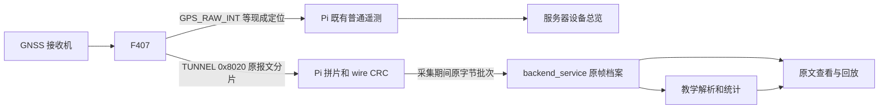

# GNSS 实验接口与服务器对接

版本：v1，2026-11-10。本文面向服务器开发，范围为 Pi GNSS 采集接口、服务器接入和课堂流程。F407 已由用户确认完成改造；本轮不修改 F407 或服务器。软件测试与真实设备、服务器和网页联调分别验收。

Pi 侧已实现，初版通过 Release 构建和 73/73 项软件测试，包括真实进程、PTY、本地 Broker 的 GNSS 集成。功能默认关闭，现场通过 `gnss.enabled` 显式启用；软件验证、部署和跨端真机验收分别记录，证据和复现命令见 [验证记录](validation/2026-11-10-gnss-pi.md)。

## 1. 实验目标与数据分工

让学生先看接收机实际输出的 NMEA 文本或 UBX 字节，再对照字段理解搜星、定位状态、经纬度和卫星信息的变化。这里的“原始报文”是接收机输出的协议帧，不代表卫星射频采样、伪距或载波相位观测量。

普通定位和实验原文并行：



| 部件 | 本接口职责 |
| --- | --- |
| F407 | 并行提供普通定位摘要和接收机完整原报文的 0x8020 分片。 |
| Pi 普通遥测 | 保持既有 GPS_RAW_INT 等解码和 JSON 遥测；不依赖是否开始实验。GPS_RAW_INT 的名称不表示其中装有 NMEA/UBX 字节。 |
| Pi GNSS 实验 | 复用唯一 F407 MAVLink 接收者，检查分片、重组、校验运输 CRC，执行开始/停止/状态查询，保存有界本地日志并上传原字节。首版不在 Pi 解析经纬度。 |
| route_service | 复用现有实验动作路由和 ACK；扩充 GNSS 动作协议。无需再存一套 raw 档案。 |
| backend_service | 拥有会话和采集轮次，订阅 raw，校验入口、持久化去重、教学解析、统计、回放和导出。 |
| 前端 | 原文优先展示；按需展开字段、换算和曲线。环境说明、学生答案和评分属于服务器。 |

原帧不塞入普通 telemetry、动作 ACK 或设备最新状态缓存。普通总览继续使用现成定位；实验图表取自本轮 raw 档案，不能用总览最新坐标代替本轮证据。

## 2. 配置和前置条件

Pi 配置增加可选项，旧配置兼容，默认关闭：

```json
{
  "gnss": {
    "enabled": true,
    "archive_directory": "/var/lib/cns-rpi/gnss"
  }
}
```

`enabled` 为布尔值，`archive_directory` 为非空绝对路径。目录由部署方配置，动作请求不能指定文件路径。服务运行账户必须能够写入该目录。

部署时保留现场配置，只增加或修改上述 `gnss` 节。使用现有服务账户 `dcdw` 时，启用前准备目录：

```sh
sudo install -d -o dcdw -g dcdw /var/lib/cns-rpi/gnss
```

随后按既有发布方式更新程序、启用配置并重启服务；若现场服务账户不同，目录属主相应替换。重启前先结束活动实验。当前 Pi 普通 GPS 遥测解码和 JSON serializer 未因本功能改变。

开始采集需要 Pi 已启用 GNSS、当前 F407 身份已经核验、设备 MQTT 连接可用。业务身份沿用 F407 的箱子 `device_id`，不另给 GNSS 模块或 Pi 分配实验设备身份。实验不另开串口、不修改接收机输出参数、不复位 GNSS、不借用 RTK/PX4 端口。

## 3. MQTT Topic

以下 `namespace` 使用 Pi 现有 MQTT 命名空间，示例为 `cns_rpi`。

| 方向 | Topic | QoS | retain | 用途 |
| --- | --- | --- | --- | --- |
| 服务器 → Pi | `{namespace}/{device_id}/experiment/set` | 2 | false | 开始、停止、状态查询；复用既有动作路由。 |
| Pi → 服务器 | `{namespace}/{device_id}/experiment/ack` | 2 | false | 小型动作结果；复用既有 ACK 路由。 |
| Pi → backend_service | `{namespace}/{device_id}/gnss/raw/v1` | 1 | false | 新增的原帧批次，后端直接订阅。 |

backend_service 需要显式订阅 `{namespace}/+/gnss/raw/v1`，订阅 QoS 1，并在应用入口核对 Topic 中设备与载荷、会话和采集归属。设备注册或已有 snapshot 订阅不会自动接收这个新 Topic。broker 的发布/订阅权限也需包含相应新 Topic。

MQTT QoS 1 允许重复投递。Pi 的 MQTT 完成回调对应 broker 的 PUBACK，仅表示 broker 层确认，不能显示为“服务器已存档”。服务器以数据库提交成功的帧数和最后存档时间单独反馈。

## 4. 动作信封

动作载荷上限为 4096 字节，JSON 不接受未知字段。沿用现有信封，Pi 侧包含 `command_id`：

```json
{
  "schema_version": 1,
  "command_id": "00000000-0000-4000-8000-000000000001",
  "request_id": "00000000-0000-4000-8000-000000000003",
  "target": { "device_id": "DCDWCNS1GNSS0000001" },
  "session_id": "00000000-0000-4000-8000-000000000002",
  "action_id": "00000000-0000-4000-8000-000000000003",
  "lease_version": 1,
  "operation": "gnss_capture_start",
  "expires_at": "2026-11-10T08:00:30.000Z",
  "parameters": {
    "capture_id": "00000000-0000-4000-8000-000000000004",
    "duration_seconds": 300
  }
}
```

示例时间仅为格式示例，实际下发须生成未来有效时间。服务器经 route_service 下发时，继续由现有路由生成设备侧 `command_id`，不绕过当前动作机制。当前 route_service 的动作有效期窗口不超过 30 秒；采集时长 300 秒不代表把动作受理有效期也设成 300 秒。

| 字段 | 规则 |
| --- | --- |
| `schema_version` | 整数 1。 |
| `command_id` | 本次设备侧投递 UUID；重试可变化。 |
| `request_id`、`action_id` | UUID，二者必须相等，标识同一次逻辑动作。 |
| `session_id` | UUID，一次完整课堂实验，可包含多次 capture。 |
| `target.device_id` | 当前箱子业务身份，与 Topic 一致。 |
| `lease_version` | 正整数；沿用现有会话租约，防止旧会话控制新采集。 |
| `operation` | 仅以下三种操作之一。 |
| `expires_at` | UTC，固定 `YYYY-MM-DDTHH:MM:SS.mmmZ`；是动作受理期限，不是采集结束时刻。 |

### 4.1 `gnss_capture_start`

必需 `parameters`，且只能包含：

```json
{"capture_id":"00000000-0000-4000-8000-000000000004","duration_seconds":300}
```

`capture_id` 为 UUID，服务器每轮新建，不复用旧轮次 ID。`duration_seconds` 为 1～1800 的整数。一个设备同时只有一轮活动采集。开始建立本地档案、清理开始前未完成的分片；采集时间使用 Pi 单调时钟，不受 UTC 校时跳变影响。

开始 ACK 的 `completed` 仅表示采集任务已建立，不能解释为已有原帧、已经定位、环境准备完成或服务器归档完成。

### 4.2 `gnss_capture_stop`

信封同上，使用新的 `command_id`、`request_id/action_id`，`operation` 改为 `gnss_capture_stop`，参数只有：

```json
{"capture_id":"00000000-0000-4000-8000-000000000004"}
```

必须针对明确轮次并符合会话归属。结束只停止本轮实验采集和上传，不停止普通遥测，不关闭或重配 GNSS。服务器结束实验、用户离开页面或失去租约时，应使用现有会话策略停止本轮，不能仅让浏览器停止刷新。

### 4.3 `gnss_status`

信封同上，使用新的动作 ID，`operation` 改为 `gnss_status`，整个 `parameters` 字段省略，不能传空对象。用于查询采集终态、计数和诊断。每次要取得新状态时创建新 `action_id`；重试旧动作只会得到首次状态快照。

## 5. 幂等和状态约定

- Pi 在进程内按 `action_id` 保存已完成动作结果。同一逻辑动作重投仅允许 `command_id` 改变，返回首次结果和首次观测时间，不重复开始、停止或重新采样状态。入口或业务拒绝不进入完成缓存，条件恢复后相同动作可被重新评估；服务器须按实际 ACK 更新结果。
- 同一 `action_id` 更改操作、参数、会话、目标、租约或有效期，视为动作冲突。
- 缓存最多 128 项，终态至少保留 300 秒；这是进程内重试去重，不是持久化命令日志。服务器负责持久化逻辑动作。
- 设备进程重启不会恢复活动 capture。服务器将上一轮标记为中断或完整性未确认，用新 `capture_id` 开始新轮，不能把重启前后记录静默接成一轮。
- 到时自动结束后，服务器通过新 `gnss_status` 查询确认终态，再结合已存档记录判断资料完整性。没有 raw 不等于结束，raw 停更也不等于 GNSS 无定位。

Pi ACK 沿用 `schema_version`、`command_id`、`session_id`、`action_id`、`operation`、`observed_at`、`status`、`fact.gnss`，失败时带 `error_code`。ACK 状态表示动作执行结果，`fact.gnss` 表示采集事实；它们与接收机的定位状态是不同维度。例如开始成功后：

```json
{
  "schema_version": 1,
  "command_id": "00000000-0000-4000-8000-000000000001",
  "session_id": "00000000-0000-4000-8000-000000000002",
  "action_id": "00000000-0000-4000-8000-000000000003",
  "operation": "gnss_capture_start",
  "observed_at": "2026-11-10T08:00:00.000Z",
  "status": "completed",
  "fact": {
    "gnss": {
      "enabled": true,
      "state": "capturing",
      "capture_id": "00000000-0000-4000-8000-000000000004",
      "session_id": "00000000-0000-4000-8000-000000000002",
      "frames": 0,
      "raw_bytes": 0,
      "source_checksum_bad_frames": 0,
      "queued_batches": 0,
      "confirmed_batches": 0,
      "end_reason": "",
      "transport_counters": {
        "scope": "process_lifetime",
        "scope": "process_lifetime",
        "fragments_received": 0,
        "frames_completed": 0,
        "invalid_fragments": 0,
        "timed_out_frames": 0,
        "conflicting_frames": 0,
        "wire_crc_errors": 0,
        "duplicate_fragments": 0,
        "duplicate_frames": 0,
        "evicted_frames": 0
      }
    }
  }
}
```

| `fact.gnss` 字段 | 含义 |
| --- | --- |
| `enabled` | 设备配置是否启用本功能。 |
| `state` | `idle` 未建轮、`capturing` 采集中、`completed` 正常结束、`failed` 异常终止。不是 GNSS 定位状态。 |
| `capture_id`、`session_id` | 当前或最后一轮归属，尚无轮次时为 null。 |
| `frames`、`raw_bytes` | 本轮采集原帧数量与原字节数；不等于服务器存档数量。 |
| `source_checksum_bad_frames` | 本轮原协议校验标为 BAD 的完整帧数量。 |
| `queued_batches` | 当前尚未确认的原文批次数。 |
| `confirmed_batches` | 本轮收到 broker PUBACK 的批次数，不是服务器数据库提交数。 |
| `end_reason` | 结束原因；活动轮次为空字符串。 |
| `transport_counters` | 拼片器进程生命周期诊断，`scope="process_lifetime"`，跨轮累计；不拿它计算某轮物理丢包率。 |

`transport_counters` 中，`duplicate_fragments` 表示尚在拼片的同一片重复收到；`duplicate_frames` 计数已完成组键的迟到/重复分片被抑制次数，不是“重复完整原帧数”。`timed_out_frames`、`conflicting_frames`、`wire_crc_errors`、`evicted_frames` 分别表示超时组、冲突组、完整 wire CRC 错误组和容量淘汰组；`invalid_fragments` 为入口片校验失败数。

无法通过结构校验或无法关联当前绑定身份/Topic 的请求，不生成猜测性 ACK，只记录设备诊断；服务器在自己的入口拒绝非法请求。对可安全关联的合法动作，业务条件不满足时返回 `status="rejected"` 和 `error_code`。服务器不要通过重复发送新 action_id 绕过正在执行的采集或清除错误状态。

| `error_code` | 含义 |
| --- | --- |
| `wrong_target` | 信封目标与当前绑定箱子不同。 |
| `action_conflict` | 已完成的同一 action_id 被用于不同内容。 |
| `expired`、`stale_lease` | 已过期或租约落后；同版本租约不能跨 session。 |
| `action_cache_full` | 300 秒内的完成动作缓存已达 128 项，等待回收后重试。 |
| `gnss_disabled`、`device_not_live` | 功能关闭，或开始时 MQTT/串口/当前身份核验条件未满足。 |
| `capture_busy`、`delivery_pending` | 正在采集，或前轮原文批次尚未确认。 |
| `capture_conflict` | capture_id 与当前/最后一轮或两份本地档案的轮次重复；每轮必须生成新 UUID。 |
| `capture_not_found`、`capture_owner_mismatch`、`capture_mismatch` | 停止动作没有对应轮次、session 不符或 capture_id 不符。 |
| `archive_open_failed`、`archive_write_failed` | 归档目录/轮换/打开失败或初始元数据写盘失败。 |

`end_reason` 正常结束值为 `capture_stopped`、`duration_elapsed`。异常值包括 `serial_disconnected`、`serial_reset`、`device_identity_unavailable`、`mqtt_disconnected`、`upload_failed`、`upload_timeout`、`batch_queue_full`、`archive_write_failed`、`archive_limit`、`process_stopping`。停止一个已经结束的匹配轮次返回当前事实，不把失败轮次改写为成功。停止动作的 `completed` 只表示停止请求已处理，仍须检查 `fact.gnss.state/end_reason`。

## 6. 原帧上传与记录身份

一条 MQTT 消息不超过 16384 字节，最多 32 条完整原帧；200ms 是由 Pi 主循环推进的组批等待目标，达到条件时形成批次，不是网络交付时限。单个恢复后的原帧不跨 MQTT 消息再次分片。字节以标准 Base64 表示，不能对二进制做 UTF-8 转换，也不能裁掉末尾的 `00`、空白或 NMEA 实际行尾。

完整批次示例：

```json
{
  "schema_version": 1,
  "device_id": "DCDWCNS1GNSS0000001",
  "session_id": "00000000-0000-4000-8000-000000000002",
  "capture_id": "00000000-0000-4000-8000-000000000004",
  "batch_seq": 1,
  "observed_at": "2026-11-10T08:00:00.200Z",
  "frames": [
    {
      "record_seq": 1,
      "elapsed_ms": 100,
      "received_at": "2026-11-10T08:00:00.100Z",
      "source": {
        "system_id": 1,
        "component_id": 193,
        "frame_id": 42,
        "received_uptime_ms": 123400
      },
      "protocol": "nmea",
      "nmea_type": 1,
      "ubx_class": 0,
      "ubx_id": 0,
      "source_checksum_valid": true,
      "wire_crc16": 48007,
      "raw_base64": "JEdQR0dBLDEyMzUxOSw0ODA3LjAzOCxOLDAxMTMxLjAwMCxFLDEsMDgsMC45LDU0NS40LE0sNDYuOSxNLCwqNDcNCg==",
      "raw_length": 67
    }
  ]
}
```

示例 Base64 恢复为 67 字节，包含 NMEA 的 CR/LF：`$GPGGA,123519,4807.038,N,01131.000,E,1,08,0.9,545.4,M,46.9,M,,*47\r\n`。示例坐标仅为协议样本，不能显示成当前箱子的实测位置。

| 批次字段 | 含义 |
| --- | --- |
| `schema_version` | 整数 1。 |
| `device_id`、`session_id`、`capture_id` | 归属，与 Topic 及服务器采集记录核对。 |
| `batch_seq` | 本轮从 1 开始的批次序号；帧去重仍使用 capture_id + record_seq。 |
| `observed_at` | Pi 组批时刻，UTC 毫秒字符串。 |
| `frames` | 1～32 条完整原帧。 |

逐帧字段：

| 内容 | 解释 |
| --- | --- |
| `record_seq` | Pi 本轮从 1 开始的连续记录序号；与 capture_id 共同作为原帧去重键。 |
| `source.system_id/component_id` | 原 MAVLink 来源，不替代业务 device_id。 |
| `source.frame_id/received_uptime_ms` | F407 封装元数据，均可为 0、可回绕、重启可复用；不能作为全局唯一键。 |
| `protocol` | `nmea` 或 `ubx`。 |
| `nmea_type`、`ubx_class`、`ubx_id` | 数字，与第10节源枚举一致；便于筛选，不证明服务器已支持解析该消息。 |
| `source_checksum_valid` | 布尔值，F407 对原 NMEA/UBX 校验结果的标记；false 的完整帧仍上传。 |
| `wire_crc16` | F407 到 Pi 运输完整原字节的 CRC16，与原协议校验分开。 |
| `received_at`、`elapsed_ms` | Pi 恢复完整帧的 UTC 时刻、相对开始的单调毫秒数；不是 GNSS 测量历元。 |
| `raw_base64`、`raw_length` | 完整原字节及长度；原档案事实，解析结果不能覆盖它。 |

服务器在 raw 入口一次完成载荷大小、结构、归属、Base64 和恢复长度检查，然后向档案、解析器传递确定类型的记录。去重键建议 `(capture_id, record_seq)`，并保留 device/session 关联；重复键原字节和元数据相同不重复计数，内容冲突单独报错，不覆盖首份证据。

Pi 的完整恢复数量、broker 完成数量和服务器已存档数量分别保存，不能混用。`frame_id` 缺口不能直接换算成物理丢帧率。

## 7. 留存和中断

Pi 本地使用 `current.jsonl`、`previous.jsonl` 两份有界档案，每份最多 16MiB。新一轮开始轮换当前档案，JSONL 记录以 `kind` 区分 `metadata`、`raw`、`summary`，分别保存采集元数据、逐帧原字节和终态摘要。服务器必须持久保存完整历史，不能依赖设备归档；Pi 两份文件用于现场取证。

| JSONL 记录 | 字段 |
| --- | --- |
| `kind="metadata"` | `schema_version=1`、`device_id`、`session_id`、`capture_id`、`observed_at`、`duration_seconds`。 |
| `kind="raw"` | 与第6节单 frame 相同的字段平铺，加上 `kind`。归属取同一文件 metadata。 |
| `kind="summary"` | `observed_at`、`gnss`，后者为完整状态事实。 |

raw 待发队列最多 8 批。断开 MQTT、失去当前 F407 核验、运输连接断开、上传队列满、写盘失败或本轮档案达到容量上限时，Pi 终止本轮并保留明确诊断。首版不提供无限离线队列、后台跨天补传或自动恢复采集。需要补资料时按本地日志显式导入，服务器仍按原 capture 和序号去重。

Pi 进程重启不会自动续采，也不会把本地档案自动补发到 MQTT。

结束时已经产生的待发批次可能晚于停止 ACK 到达。服务器按 capture 归属接收这些尾部记录，不能收到 ACK 就立即关闭 raw 入口；在核对 Pi 终态和服务器存档数量后再将该轮标记为完整、存在已知缺口或完整性未确认。

## 8. 服务器教学解析与统计

### 8.1 原文、解释和曲线可追溯

保存不可变原字节、逐帧元数据、接收时间、解析器版本。解析结果引用 `(capture_id, record_seq)`；曲线点引用原帧及字段或字节范围。解析器更新后可重算解释，不能改写原档案。

首版 NMEA 优先适配设备实际输出的 GGA、RMC、GSA、GSV：

| 报文 | 学生观察 |
| --- | --- |
| GGA | UTC、度分坐标和半球、定位质量、参与定位卫星数、HDOP、高度和参考面。 |
| RMC | 有效性、日期时间、坐标，和 GGA 对照。 |
| GSA | 无定位/2D/3D、参与解算卫星和 DOP。 |
| GSV | 可见卫星、仰角、方位角、信号强度字段及多句周期。 |

空字段显示“未提供”，不填 0；参与定位卫星数不写成可见卫星数。GSV 按实际 talker、信号和多句周期合并，不能把各句重复总数相加。HDOP 不是米制定位精度。

UBX 先显示十六进制和帧结构：`B5 62`、class/id、小端 payload 长度、payload、CK_A/CK_B。payload 解析按确认的模块及协议版本逐项启用。未知 UBX 显示“暂未解码”，原文继续保存；不能假定实际一定输出 NAV-PVT、NAV-SAT 或原始观测消息。

原协议校验 BAD 的完整帧保留并显示问题，不进入有效位置统计。服务器教学解析可以重新核算原协议校验，并分别保存 F407 标记和服务器校验结果，不能和 wire CRC 混成一个“校验通过”。

### 8.2 四类状态分别显示

| 原文事实 | 页面含义 |
| --- | --- |
| 原报文更新，字段明确无有效定位 | “有原报文，未定位”。 |
| 原报文更新且位置有效 | “有原报文，有效定位”，展示该位置历元。 |
| 原报文更新但所需位置语句停更/未知 | “原报文更新，位置数据过期/未知”。 |
| 原报文停更、拼片超时或运输错误 | “数据停更/链路异常”，保留最后时间；不能据此判 GNSS 无定位。 |

新鲜度按实际消息周期配置，工程起点可取期望周期的 3 倍；未获得输出配置时显示未知，不能给所有类型统一套固定门限。普通页面也要把旧坐标标为最后位置，不能继续冒充当前定位。

### 8.3 比较规则

首版统一选定一类实际输出的位置主来源并记入轮次元数据。同历元 GGA/RMC/UBX 用于对照，不重复算成多个位置样本。位置统计仅使用本轮、源校验正确、已支持解析、定位明确有效的新记录。

建议按统一的 1 秒时间格记录有效位置、明确无效、没有新样本，分别统计定位可用性和数据缺口，不能以报文条数作分母。没有已知参考坐标时报告静态散布与稳定性，不报告绝对误差或绝对精度。不同物理位置采集的两轮围绕各自中心比较散布，不能把两轮均值的距离直接称为环境导致的误差。

经纬度练习和散点使用原始 GNSS 坐标及单位；地图如需坐标转换，只用于地图呈现。

## 9. 学生流程和实际环境边界

现有方块式 GPS 模块可不拆机取下，但线长允许的移动范围很有限。基础课在固定安装位置即可完成，不强制每组搬到室内、窗边、室外各测一次。

| 步骤 | 学生操作 | 服务器要提供 |
| --- | --- | --- |
| 1 | 选择箱子，记录安装、位置和环境。 | 当前设备状态、普通定位状态、现场/历史来源标识。 |
| 2 | 开始一轮，冻结一条原文阅读。 | NMEA 原文或 UBX 十六进制、时间、长度、校验；暂停滚动继续采集。 |
| 3 | 找状态、坐标或卫星字段，再展开解释。 | 字段位置、原值、单位、换算及对应原帧。 |
| 4 | 静置观察，建议先采 5 分钟。 | 状态时间线、原帧更新、有效位置时的散点和经纬度曲线。 |
| 5 | 结束并填写结论。 | 停止 ACK、Pi 终态、服务器存档计数和完整性说明。 |
| 6 | 条件允许时开新一轮比较。 | 多轮同指标对照及真实原文回放。 |

小范围改变朝向、局部遮挡只是接收条件探索，不保证掉星、失锁或明显漂移；先由教师做一次实物验证。不能因为挪动几厘米就认定完成不同环境对比。若现场不能形成差异，使用教师预先在不同环境采集的真实档案，明确标注历史回放和采集条件。

进入实验时可能已经定位，不强求重现从无定位到定位。记录的等待时间只能称“本轮观察到首次有效位置的等待时间”，不能当冷启动 TTFF。室内全程无定位也保留为真实结果，可完成原文、校验、更新周期和状态阅读；不能生成假实时坐标或 UBX 帧。

## 10. F407 → Pi 0x8020 契约摘要

本节用于双方排查运输问题；服务器通常接收 Pi 已恢复的完整帧，无需再次拼 40B 片。依据用户提供的《GPS原始帧_树莓派MAVLink接口》2026-11-06 版；F407 已改造与真机逐字节验收是两项事实。

- UART6，115200、8N1；MAVLink 2 `TUNNEL`，消息 385、CRC extra 147。
- 来源 system ID 为设备 Node ID，component ID 为 193。`payload_type=0x8020`，target system/component 均为 0。
- `payload_length=24+data_length`，使用 TUNNEL 的 128B payload 前部；MAVLink 2 尾零裁剪由官方解码恢复，不能对内层数据做 `rstrip`。
- 内层整数均为小端，分片数据最多 40B，NMEA 完整帧最多 128B，UBX 最多 1024B。

| 偏移 | 类型 | 字段与规则 |
| --- | --- | --- |
| 0 | u8 | version=1。 |
| 1 | u8 | protocol：1=NMEA，2=UBX。 |
| 2 | u8 | flags：bit0 原协议校验正确；bit1=1 表示附带 wire CRC；其余位为 0。 |
| 3 | u8 | header_length=24。 |
| 4 | u32 | frame_id，0 有效，可回绕。 |
| 8 | u32 | received_uptime_ms，F407 启动后接收时间，0 有效，不是 UTC/PPS。 |
| 12 | u16 | frame_length，包含原协议全部字节。 |
| 14 | u16 | fragment_offset=40×fragment_index。 |
| 16 | u8 | fragment_index，从 0 开始。 |
| 17 | u8 | fragment_count=ceil(frame_length/40)，最多 26。 |
| 18 | u8 | data_length=min(40, frame_length-fragment_offset)。 |
| 19 | u8 | nmea_type：0=其他，1=GGA，2=RMC，3=GSA，4=GSV；UBX 时为 0。 |
| 20 | u8 | ubx_class；NMEA 时为 0。 |
| 21 | u8 | ubx_id；NMEA 时为 0。 |
| 22 | u16 | wire_crc16，覆盖完整原字节。 |
| 24 | bytes | 本片原数据。 |

wire CRC 使用 CRC16-CCITT-FALSE：poly=0x1021、init=0xFFFF、无反射、xorout=0，`123456789` 校验值为 `0x29B1`。同一组各片的协议、长度、数量、类型、flags、wire CRC 必须一致，否则整组拒绝。

Pi 最多保留 32 个未完成组，从首片起 5 秒超时，重复片不延长时限。NMEA 实际行尾、UBX 二进制 0、原协议校验 BAD 均保留。半帧、噪声、超长报文、F407 队满可能不被转发；本接口不保证接收机 UART 全字节流无损。

## 11. 服务器实施清单

以下路径来自本地 cns_server 只读核对；实施时以服务器目标分支为准。本轮 Pi 改造未修改这些文件。

| 接点 | 所需改动 |
| --- | --- |
| `backend_service/protocol/src/experiments.ts` 与 route_service 设备动作协议 | 增加三种 GNSS operation、start/stop 参数、`fact.gnss` 和错误；同时覆盖创建动作、持久化动作、route request、device command、device ACK 及 operation/fact 匹配，保持动作 4096B 上限。新增独立 raw v1 schema，不能直接放宽所有 ACK 大小。 |
| `route_service/src/core/command/experiment_policy.*` 及其动作解析/类型 | 允许 GNSS 操作并保留参数，经既有目标、有效期、幂等和租约路由；转发设备 ACK。 |
| `backend_service/src/route/routeServiceGateway.ts` | 新增 raw Topic、QoS1 订阅和明确消息分流回调；避免落入 snapshot/realtime 解码器。现有 `buildTopics` 和 `waitUntilSubscribed` 没有 raw 入口。 |
| `backend_service/src/experiments/experimentActionDispatcher.ts` | `publishClaimed` 为 GNSS start/stop 携带 parameters；不能只沿用当前 RTK 特例。 |
| `backend_service/src/experiments/postgresExperimentActionStore.ts` 及动作模型 | 为 GNSS 场景开放三种动作；持久化、恢复、转发 capture 参数，按设备/会话/租约校验归属。 |
| `backend_service/src/experiments/catalog.ts` | GNSS 当前为 `coming_soon`；只有后端、前端与真机验收具备后再改可用性。 |
| 新 GNSS 档案服务和数据库迁移 | capture 元数据、逐帧原文、唯一去重键、解析版本、统计和完整性；不要依赖只保存“最新遥测”的缓存。 |
| 新 GNSS API/WebSocket | 创建/结束/状态、按序分页 raw、按原帧读取解释、曲线、回放、两轮比较、导出。WebSocket 断线后用序号补读持久化数据。 |
| GNSS 前端 | 左侧步骤、上方真实链路和采集状态、原文与解释联动、轮次标注、实时/历史区别、结果和缺测展示。 |

建议数据库最少分为 `gnss_captures`、`gnss_raw_frames`、`gnss_parsed_frames`。capture 保存真实/历史来源、环境、安装姿态、持续供电情况、接收机已知型号和输出配置、统计主来源、Pi 终态与服务器归档状态。raw 保存不可变原字节；parsed 保存解析版本、结果和错误。具体表名、REST URL 由服务器实现确定，不作为 Pi 设备协议的一部分。

## 12. 联调验收

1. 未开始、采集中、停止后普通定位遥测均持续更新，设备总览可正常显示；实验不影响心跳、身份或其他已启用通道。
2. 使用已知 NMEA 和 UBX 样本核对端到端原字节，包括 CR/LF、尾部 0、原协议校验 BAD；错误 wire CRC、冲突片、缺片、重复片分开记录。
3. 重试相同开始/停止动作不重复执行；不同会话、错误 capture、旧租约和冲突动作拒绝；新状态查询使用新 action_id。
4. 验证手动结束、到时结束、无原帧结束、断网、串口重连和写盘故障，服务器显示真实终态和资料完整性，不把无原帧当无定位。
5. QoS1 重复批次不重复统计，停止 ACK 后到达的尾批仍正确归档，broker 确认和数据库存档分开显示。
6. 页面任一点可追溯原帧与字段；空值、未知 UBX、源校验 BAD、位置过期均不会生成有效位置点。
7. 固定位置真实原文完成基础实验。环境比较按现场可实现范围验收；历史真实记录显式标注，不冒充本轮现场数据。

本轮自动化测试只证明 Pi 软件和模拟运输链路行为。真实 GNSS → F407 → Pi → broker → backend_service → 网页的联调、实际输出消息清单和环境差异仍需现场采样验收。
