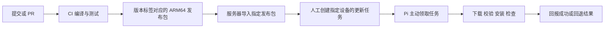

# 树莓派首次部署、远程维护与持续集成设计

日期：2026-11-03。状态：按用户确认的产品效果实施，技术方案由实施者决定。源码基线：`cef3be8` / `v1.0.5`。

最终效果：Web 点击指定设备、指定版本的更新，Web 后端发布更新消息，服务器订阅并持久化任务，Pi 主动领取、安装并回报，结果返回 Web。用户不要求审阅技术实现。复用现有 `cns_rpi/sources/web-console/` 来源模式，新增 `maintenance/request` 与 `maintenance/ack`；服务器显式关联业务 `device_id` 与维护 `node_id`。普通业务命令的在线/会话要求和短超时不作为更新任务前置条件。

## 1. 已确认的目标与边界

用户已确认：

- 维护对象包括异地、只有 5G 物联卡的树莓派，版本交付经过服务器中转。
- 人工确认目标设备和指定版本后才更新；设备定期领取任务不等于自动安装最新版本。
- CI 预编译 Raspberry Pi OS trixie 对应的 ARM64 包，Pi 只安装，不在现场编译。
- 维护入口采用服务器任务 API 与 Pi 主动领取任务，不以反向 SSH 为默认维护入口。
- 不做远程 MAVLink；之前列出的实验和硬件验收项暂不处理。

本轮交付分为：Pi 首次安装入口、版本包与安装/回退、独立维护服务、CI，以及服务器接口契约。本仓库实现 Pi 和 CI 部分；服务器任务持久化、管理端授权和发布包托管需由服务器工作线配套，不能将接口文档当成现网 API 已实现。

首版维护动作包含业务程序或 5G 拨号组件的指定版本安装、回退、版本/服务状态回报，每个任务只更新一个组件。维护程序随首次部署安装，首版不接受维护程序自身的远程更新任务。任意 Shell、远程桌面、系统整盘升级、预装系统镜像和自动追随最新版不在本轮范围。

## 2. 方案选择

| 维度 | 采用方式 | 已比较的另一方式与取舍 |
|---|---|---|
| 版本交付 | CI 构建 trixie ARM64 包 | Pi 拉源码编译改动较小，但更新耗时更长，且依赖现场编译环境；用户选择预编译包。 |
| 维护入口 | 服务器任务 API + Pi 定期领取 | 反向 SSH 复用工具、实现较少，但需要逐台登录；用户选择便于批量管理的任务方式。 |
| 更新触发 | 人工选定设备、版本及组件 | CI 通过只代表生成可发布产物，不直接触发设备安装。 |

以下为本方案提出的默认值，尚未作为用户额外要求：保留现有 `dcdw` 运行用户；首次部署使用原版系统加初始化命令；领取周期 60 秒；使用版本目录切换和上一版本回退。

## 3. 当前可复用内容与实际缺口

- `scripts/deploy.sh` 已有配置迁移、主程序与拨号配置预检、现场配置防覆盖、helper 安装逻辑，可复用其实现和测试。
- 当前业务服务直接运行 `/home/dcdw/cns_rpi/build/cns_rpi`，5G 服务从同一源码目录加载 Python，尚无独立发布包和版本切换。
- 当前部署会同时重启业务及 5G 服务。若维护经过 5G，普通业务更新也会主动切断维护网络，必须调整。
- 当前没有 `.github/workflows` 和打包入口。已有 54 个 CTest，可继续作为基础回归。
- 目标固定为 Pi 5、Raspberry Pi OS 64-bit、trixie；不顺带泛化任意 Linux、ARM32 或任意用户名。

## 4. 端到端流程



CI 不需要访问现场 Pi。Pi 不需要公网入站地址，也不依赖能直连 GitHub。发布包和 API 使用物联卡可达的服务器入口；服务器不能把 Pi 下载请求重定向到不可达的 GitHub/CDN 地址。

## 5. 首次部署

首次部署按工厂/现场准备阶段有局域网或 Wi-Fi 可访问服务器及 apt 源设计。烧录原版 trixie 64-bit 系统，准备 `dcdw` 用户和 SSH 后，执行初始化命令。部署后的日常维护允许只剩 5G。

初始化入口接受：指定版本、服务器入口、服务器预先分配的维护节点配置文件、业务配置文件。真实令牌通过文件传入，不写入仓库或命令行参数。

初始化脚本作为独立文件与版本包一同由 CI 发布，服务器导入后提供固定下载入口；现场先下载脚本，再执行，不要求克隆仓库。它通过带节点认证的 `GET /api/maintenance/v1/releases/{version}?platform=trixie-arm64` 获取版本、完整提交号、包地址及 SHA-256，然后复用包内安装入口。脚本的分发地址、摘要和用法随部署说明交付，下载失败时不执行残缺脚本。

初始化顺序：

1. 检查目标发行版、ARM64 架构、普通可写根文件系统和已有安装状态；沿用旧只读设备迁移限制。
2. 安装运行依赖，不安装编译器、CMake、doctest 或 Git 开发依赖；不默认改写系统 apt 源。
3. 从服务器获取指定版本包，完成校验、解包、主程序和拨号配置预检。
4. 首次初始化业务配置；已有 `/var/lib/cns-rpi/config.json`、身份绑定和实验状态文件继续保留，不用样例覆盖。
5. 安装业务、5G 和维护服务，启动并回报实际版本与服务状态。

首版不承诺无网络纯 5G 新系统自举、全离线依赖包或烧录后零操作上线；这些需要另做系统镜像/依赖镜像，不能由一个应用压缩包自然获得。

现有源码部署入口继续服务开发者，后续应复用同一包安装逻辑，避免维护两套配置迁移与服务安装行为。

## 6. 发布包与运行目录

包名采用 `cns-rpi-<version>-trixie-arm64.tar.gz`。包内包含：

- `cns_rpi`、`cns_control_test` 可执行程序。
- 配套 Python 拨号模块、配置 helper、迁移工具、维护程序和 systemd 单元。
- 配置样例、安装入口、版本清单、构建提交及运行依赖清单。
- 各组件内容摘要；包外提供整包 SHA-256。

不打入现场配置、令牌、绑定文件、私钥、日志或测试二进制。版本清单记录完整 Git SHA、架构、发行版代号、工程版本和构建依赖版本。

建议目录：

| 路径 | 用途 |
|---|---|
| `/opt/cns-rpi/releases/<version>-<sha>/` | 完整、只读的已安装版本 |
| `/opt/cns-rpi/current` | 业务程序当前版本链接 |
| `/opt/cns-rpi/cellular-current` | 5G 脚本当前版本链接 |
| `/opt/cns-rpi/maintenance-current` | 维护程序当前版本链接 |
| `/var/lib/cns-rpi/` | 原有业务配置、绑定和实验持久状态 |
| `/etc/cns-rpi-maintenance.json` | 服务器地址、维护节点身份、令牌，root 可读 |
| `/var/lib/cns-rpi-maintenance/` | 当前任务、上一版本、配置备份和最近结果 |
| `/run/cns-rpi/` | 沿用业务与 5G 的共享临时目录 |

分开业务和 5G 链接的原因是实际网络连续性：普通业务升级只切换并重启业务服务，不更换仍运行的拨号脚本。维护程序与业务服务独立，业务停止或崩溃不影响领取任务和回报。

维护程序自身若更新后无法启动，任务 API 将失去执行者。因此首版不提供任务自升级，也不引入另一套自举/双维护代理系统；更换维护程序须在受控维护窗口执行初始化/安装入口。这是本方案的范围选择，不能把维护程序链接切换成功当作远程维护可用。

## 7. 服务器与 Pi 的接口契约

接口前缀建议为 `/api/maintenance/v1`。正式域名、路径挂载位置和证书由服务器部署确定，以 Pi 配置传入。

### 7.1 维护身份

服务器首次部署前为每台 Pi 分配独立 `node_id` 和节点令牌，维护配置通过受控文件交给初始化入口。该身份标识被维护的 Pi，不替代主控箱/PX4 的业务 `device_id`，不改变任何现有 MQTT Topic。

HTTPS 使用系统信任链，或首次部署显式导入的服务器 CA。请求携带该节点的 Bearer 令牌；令牌不进入业务遥测、发布包或普通日志。

### 7.2 领取与回报

Pi 在空闲时每 60 秒执行一次 `POST /nodes/{node_id}/poll`，上报平台、业务/5G/维护程序各自的当前版本与完整提交号、两个业务服务的状态及最近任务结果。一个任务执行期间不领取第二个任务。无任务时服务器返回 `job: null`；有任务时返回该节点唯一在途任务。

安装任务的核心字段：

```json
{
  "schema_version": 1,
  "acknowledged_job_id": null,
  "job": {
    "job_id": "服务器生成的唯一任务号",
    "action": "install",
    "version": "1.0.6",
    "git_commit": "完整40位提交号",
    "component": "app",
    "platform": "trixie-arm64",
    "artifact_url": "https://维护服务器/cns-rpi/releases/1.0.6/cns-rpi-1.0.6-trixie-arm64.tar.gz",
    "sha256": "整包SHA256"
  }
}
```

`action` 首版限于 `install`、`rollback`；回退目标必须是所选组件在 Pi 实际保留的上一可运行版本。`component` 首版限于 `app`、`cellular`，常规任务默认是 `app`。选择 `cellular` 代表人工明确要求更换拨号组件，网络短时中断不被伪装为业务升级成功。每个任务只有一个组件，没有跨组件组合事务；需要同时更换时由管理员依次创建任务。

Pi 回报至少含：`job_id`、阶段、当前/目标/上一版本、结果和短错误原因。终态包括 `succeeded`、`failed`、`rolled_back`、`needs_attention`。不附带令牌、现场配置或无限量日志。

服务器负责持久化人工授权任务、目标节点、版本和全部结果；每台 Pi 同时最多一个在途任务。服务器收到终态后先持久化，再以 `acknowledged_job_id` 明确确认该结果，之后才允许返回下一任务；确认和下一任务可出现在同一响应。Pi 未收到对应确认前保留原任务终态并重复回报，不覆盖记录。任务重复返回时 Pi 回报已有结果，不重复安装。服务器不得在新任务已执行后重新投递更早的旧任务。

网络不可达时维持当前版本，保留最近结果，下次定期领取时重报。没有服务器任务不安装版本；单纯出现新 Release 不构成更新授权。

### 7.3 服务器工作线需要提供的交付物

- 节点建档、令牌分配及停用能力。
- 已验证发布包的导入、静态下载与版本清单；Pi 下载只走可达的中转入口。
- 上述指定版本查询接口，返回与安装任务一致的包元数据，供首次部署解析版本。
- 人工创建指定节点/批次、指定版本/组件的任务，以及上述领取/回报 API。
- 持久化当前版本、任务进展和结果，管理入口显示实际回报，不能只把任务已发出当成功。

这些管理接口独立于业务 `experiment/set`、MQTT 会话和远程 MAVLink；不把任意下载 URL 或 Shell 指令塞入业务实验协议。

## 8. 安装、检查与回退

维护服务使用独立 systemd oneshot/timer 执行，不依赖业务主进程；其安装、切换版本和控制服务需要 root 权限，业务与 5G 仍以 `dcdw` 运行。

正常安装流程：领取并校验任务入口 → 下载到候选目录 → 检查整包摘要、目标平台、版本和 ELF 运行依赖 → 对现场配置副本做真实预检 → 保存上一版本与配置备份 → 停止所选组件 → 切换对应链接 → 启动并检查 → 持久化终态并回报。

每个组件分别保存当前和上一可运行版本。配置迁移和配置 helper 归业务组件管理，helper 跟随业务版本切换与回退。业务更新后的配置必须同时通过新业务程序和当前 5G 脚本的预检，否则在停止服务前拒绝安装；5G 任务只验证并使用现有配置，不顺带迁移或改写业务配置。这样无需为部分更新引入跨组件配置事务。

人工回退同样在停止服务前，用目标旧组件与当前另一组件预检拟恢复的配置；不兼容则拒绝回退，避免另一组件在后续升级后被旧配置破坏。

下载、摘要或预检失败时不停止当前服务。包下载完整之前不切换版本。包输入的路径和元数据在安装入口校验一次，内部使用已确认的类型与路径。

默认业务检查覆盖至少一个 30 秒 watchdog 周期，建议观察 40 秒：主服务保持 active、进程不反复重启、实际运行文件对应目标版本。串口没插、F407 不在线或暂时连不上 MQTT 不直接等价于升级失败。

新业务版本启动/存活检查失败时切回上一业务版本及本次安装前保存的配置，重新启动并回报 `rolled_back`；旧版本也无法启动则回报 `needs_attention`，不循环切换。原有身份绑定、动作去重和其他业务持久状态不随配置备份回退或清空。

若安装期间进程或整机重启，维护服务先对照已保存任务和实际版本；能够确定已完成的回报原事实，不能确定的进入 `needs_attention`，不盲目重做变更。

5G 组件更新在下载及预检完成后进行。成功条件包含新服务持续存活，以及在 180 秒观察窗口内重新完成一次经部署网络的服务器 API 请求；单凭 systemd active 不算恢复维护链路。观察失败则切回上一 5G 版本并尝试启动，结果本地保留，网络恢复后回报；无法确认恢复时记录 `needs_attention`。首次现场验证需确认仅 5G 条件，不能用 Wi-Fi 成功掩盖物联卡故障。维护服务不随 5G 服务被重启；没有回报时管理端保持未确认，不能推断更新失败或成功。

## 9. CI 与发布

- PR 和推送运行自动编译测试，不能携带现场配置或维护令牌。
- 正式发布作业使用 GitHub ARM64 运行器，在 Debian trixie ARM64 用户空间构建；不把 Ubuntu x86 测试产物直接发布给 Pi，也不使用运行器专属的 `-march=native`。
- C++23、`-Wall -Wextra` 保持；采用 trixie 的 GCC/CMake 和系统构建依赖。测试在普通用户下执行，保留 Linux PTY、回环套接字及文件权限语义。
- 运行完整 CTest，以及仓库现有独立 Python 拨号逻辑测试；CI 启动自有回环 Mosquitto，明确启用真实收发及受控重启测试，不能把条件跳过写成已测通过。
- 指定版本标签必须与 CMake 工程版本一致；全部检查通过后才生成发布包、SHA-256、版本清单及测试日志，附到对应 GitHub Release。
- 在只有运行依赖的 trixie ARM64 环境验证发布包的 `--version`、样例配置预检及依赖解析，防止包无意依赖构建机开发库。
- 服务器导入指定 Release 后才可创建设备任务。CI 发布包与服务器批准设备安装是两个独立步骤。

官方依据：[GitHub ARM64 运行器](https://docs.github.com/en/actions/reference/runners/github-hosted-runners)、[trixie GCC](https://packages.debian.org/trixie/g%2B%2B)、[trixie libmosquitto](https://packages.debian.org/trixie/libmosquitto1)。容器构建和自动测试仍不代替真实 Pi 服务切换/5G 维护链路验证。

## 10. 本轮验证标准

本轮新增功能需要验证，旧实验验收仍保持搁置：

1. CI 对真实源码执行构建与测试，能生成架构、版本、提交一致的安装包；失败作业不发布合格包。
2. 首次安装和重复安装分别验证初始化、防覆盖及平台拒绝行为。
3. 服务替身测试执行真实安装/更新入口，验证校验失败不切换、普通更新不重启 5G、失败回退、任务重投和结果重报。
4. 用本地 HTTP 测试服务器模拟任务/下载接口，执行真实维护客户端，不在测试里复制客户端逻辑。
5. 单独记录实际 GitHub Actions 运行、ARM64 包验证、实体 Pi 首装及经 5G 的指定版本更新结果；未执行的明确标为未验证。

## 11. 尚需在部署前取得的环境信息

服务器实际 API/下载地址、物联卡白名单与端口、HTTPS 信任链、每台 Pi 的维护节点配置，以及用于首次安装的现场业务配置。实现使用配置模板和本地契约测试，不填造现网参数；部署时再核对这些值。
