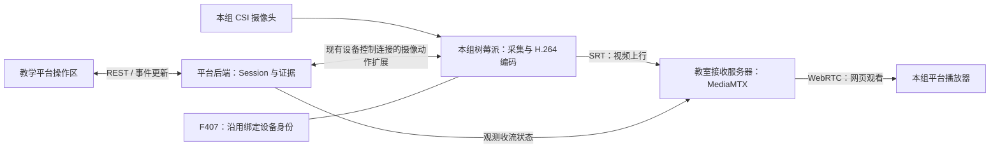

# G2 图传链路搭建与参数配置：平台实验流程设计

日期：2026-11-05

状态：流程设计稿，待评审；不代表平台功能已实现

适用：每组一套绑定的 F407＋树莓派设备，以及一只 CSI 摄像头

## 1. 实验定位与已经确定的边界

学生通过教学平台，把本组摄像头画面经过树莓派、网络和接收服务器传到网页，再完成参数对比和一次故障定位。学生需要自己连接硬件、设置参数、选择目的地、填写流名、建立播放连接，并解释观察结果。

用户已确定：每组独占一套树莓派和摄像头；树莓派与 F407 绑定；操作尽量在平台完成；实体遥控器和接收机属于 F407 的另一部分实验，当前先完成视频。

本稿的设计选择：首版使用局域网、教师预置接收服务器、两课时约 90 分钟、八个学生步骤；采用 720p/25 fps/2 Mbps 建立基线，再对比 1 Mbps 和 4 Mbps。课时、参数档位与采样时间是建议值，可由课程配置调整，不是用户已确认的硬性指标。

成功的最低含义是四项都有本次运行的事实：摄像头被识别、树莓派实际出帧、接收服务器持续收到本组流、浏览器持续解码。启动进程成功、页面打开、按钮点击、历史绿灯都不能单独证明图传成功。

当前交付仅设计流程。云端/5G、遥控链路、飞行操纵、录像回放、音频、学生安装系统和部署媒体服务不进入本节必做内容。网页图传用于教学观察，不据此承诺实际飞行的操纵延迟。

## 2. 方案选择

| 方式 | 学生承担的工作 | 教学与运维影响 | 本次取舍 |
|---|---|---|---|
| SSH 命令实验 | 登录树莓派，运行采集、推流命令 | 可见底层过程，但登录和环境差异占据课堂时间 | 作为进阶资料，不作为默认入口 |
| 平台分步搭建 | 逐步配置采集、发送、播放，读取各段反馈 | 保留配置和排障任务，教师统一准备运行环境 | 沿用用户选择 |
| 一键播放 | 平台自动配好两端，学生只点击开始 | 适合功能演示，难以考察学生是否理解链路 | 不作为实验主流程 |

不要求学生重新实现编码器或传输协议。实验重点是把已有模块正确连接起来，通过配置、证据和排障说明各段职责。

## 3. 设备与链路

沿用绑定整套设备现有的 `device_id`。树莓派不另外生成业务设备身份，摄像头作为本套设备的能力呈现。教师把现有设备标签与小组对应；首版可使用课堂分配清单，无须先建设新的分组资产管理系统。



- 视频经过网络到独立教室接收服务器；课堂验证不能只在树莓派内部向 `127.0.0.1` 发流。
- 平台控制消息携带配置、动作和状态；视频主体走媒体链路，不塞进 MQTT 或实验事件。
- 摄像动作由树莓派处理，不转发到 F407，不占用 UART 实验动作链。
- Session 入口复用现有 `cns_box`、Pi 控制在线和 `verified/cached` 身份要求。F407 仍是绑定设备的一部分，但 G2 不要求遥控器、接收机或近期 F407 遥测作为通过条件，也不套用 LINK_DIAG 的近期遥测门禁。

## 4. 教师课前准备

| 准备项 | 具体内容 | 开课前的检查结果 |
|---|---|---|
| 设备 | 为各组标好整套设备标签，核对 F407/树莓派绑定与已有身份；部署摄像功能和所需组件 | 每套 Pi 控制入口可达，身份已核验或有合法绑定缓存 |
| 摄像头 | 提供对应板型的 CSI 排线、接口示意图、统一测试图卡和运动物体 | 摄像头型号与可用参数档位已在实物核对 |
| 网络 | 预设树莓派联网方式；学生电脑、Pi、接收服务器之间具备所需连通性 | 用实际教室网络完成一次跨设备播放 |
| 接收服务器 | 部署 MediaMTX，准备“教室图传服务器”连接项，配置接收、播放入口和平台观测能力 | 发送、收流、播放三段分别可测 |
| 平台 | 发布 G2 场景、建议档位、任务说明、异常提示和结果模板 | 学生账号能选择其分配设备并进入 Session |
| 并发 | 按计划同时开课的小组数 N，运行 720p/25 fps，覆盖 4 Mbps 对比阶段 | 各组画面与流名对应，记录总流量、服务器负载、卡顿及控制响应；N 和实际结果留档 |

网络和系统部署属于教师准备。学生不需要知道 SSH 密码、修改 YAML、安装软件或查找动态 IP；设备和接收服务器的当前地址由平台展示。

课堂最小带宽估算：N 组均以 4 Mbps 上行、每组一个播放器时，媒体服务器入站和出站各约为 `4N Mbps` 的目标视频量；封装、重传和控制开销另计。这只是容量估算，实际接收吞吐及无线网络承载能力必须实测。

正式平台若使用 HTTPS，媒体播放入口也要完成相应的 HTTPS 与媒体连接配置；不能把临时 HTTP 测试页直接嵌入后当作正式集成完成。

## 5. 页面骨架

沿用现有实验工作台的步骤栏、设备选择、Session、事件与证据模式；本稿不另建一套视觉体系。

```text
G2 图传链路搭建    第03组 / 设备 DCDW-XXX    Session：进行中

摄像头识别 ── 采集/编码 ── 服务器收流 ── 浏览器播放
每段显示：当前事实、来源、观测时间；点击可查看细节

左侧步骤栏           当前步骤操作区                 证据与反馈
1 设备准备           任务目标与简短接线说明          最近动作结果
2 摄像头检测         本步必填字段、操作按钮          当前运行实际参数
3 采集配置           需要观看时显示播放器            观测时间与故障提示
4 发送配置           参数对比时显示对照表            已保存证据
5 网页播放
6 参数对比           [执行本步操作] [保存并下一步]
7 故障排查
8 提交结果           [提前结束]                      [展开技术详情]
```

页面只在需要视频观察的步骤突出播放器，前面的配置区保留足够空间。技术详情展示实际地址、协议、参数和相关日志，不用命令终端作为默认交互。

“保存并下一步”由本步证据决定是否可用，并明确列出欠缺项。学生可以回看已进入步骤；回看不推进进度、不改设备配置。已完成步骤标识与顶部当前链路状态分别显示：历史步骤通过后，当前视频断开仍要显示断开。

## 6. 学生八步流程

建议第一课时完成步骤 1—5，第二课时完成 6—8。组内可以轮换接线、平台操作和记录角色；默认一组使用一个操作页面。

| 步骤 / 建议用时 | 学生实际做什么 | 平台字段与按钮 | 应看到的真实反馈 | 允许推进的条件与保存证据 |
|---|---|---|---|---|
| 1. 设备准备 / 8 分钟 | 核对本组设备；在断电状态连接 CSI 排线；上电后在平台选择本组设备 | 设备选择；接线图；“刷新设备状态”“进入实验” | 本组设备标签、Pi 控制状态、绑定身份状态 | Pi 控制在线且绑定身份合格后创建 Session 并绑定整套设备；接线确认作为人工记录，不冒充自动检测 |
| 2. 摄像头检测 / 7 分钟 | 点击检测，核对镜头确实属于本组 | “检测摄像头” | Pi 返回的传感器型号、摄像头编号、检测时间及支持档位；未检出时给接线检查指引 | 本次检测得到可用摄像头；保存摄像头与设备对应证据 |
| 3. 采集配置 / 10 分钟 | 设置分辨率、帧率、码率；先验证本地采集与编码 | 分辨率 `1280×720`、帧率 `25 fps`、目标码率 `2 Mbps`；“试采集” | 约 3 秒有限试采集的实际格式、出帧数、持续时间、估算帧率和结束结果；无常驻后台采集 | 产生有效编码帧且实际格式与选择一致；记录目标参数与实测值。试采集不通过时不进入发送 |
| 4. 发送配置 / 10 分钟 | 选择接收服务器，填写本组流名，再启动发送 | 服务器下拉框；流名 `g2-03`；“启动推流”“停止推流” | 当前配置→启动中→Pi 出帧→服务器收到该路径；分别显示实际参数、收流时间与接收吞吐 | 同一次运行有 Pi 出帧、正确路径收流，且接收字节持续增加；不是只检查启动 ACK |
| 5. 网页播放 / 10 分钟 | 在播放区再次选择服务器，手动填流名，点击连接；移动测试物体，核对画面来源 | 播放服务器；播放流名；“连接播放”“断开播放”“开始验证” | 播放画面、实际解码尺寸、解码帧率、当前流路径；浏览器收包与解码状态分开呈现 | 对应流连续观测 10 秒，各秒解码计数均增加；学生确认运动物体与本组一致。保存播放证据和人工来源核对 |
| 6. 参数对比 / 15 分钟 | 固定分辨率、帧率和场景，分别运行 1 Mbps 与 4 Mbps，观察静态细节和运动画面 | 对照记录 A/B；“应用并重启”“采集本轮数据”“保存观察” | 每轮独立的实际参数、接收吞吐、解码帧率、卡顿观察和画面细节记录 | A/B 都有有效统计与学生观察；不要求测量值恰等于目标码率，也不预设高码率必然更流畅 |
| 7. 故障排查 / 15 分钟 | 保持发送不变，把播放流名改为错误名称；先判断故障段，再修正并验证恢复 | 诊断题；播放流名；“连接播放”“记录判断”“验证恢复” | Pi 与服务器原流仍正常，错误播放路径无流；修正后浏览器恢复解码 | 保存错误状态、学生判断、修正动作和恢复证据；仅有文字答案或重启设备不能替代本段排障证据 |
| 8. 提交结果 / 15 分钟 | 检查证据，回答结论题，停止本次图传并提交报告 | 结果预览；“停止并提交”“提前结束” | 基线、A/B、故障过程的证据列表；停止确认与提交状态 | 必做证据齐全、结论已填写、Pi 确认停止本 Session 采集推流后，标记实验完成并释放 Session 设备占用 |

首次打开播放区不自动把发送流名填入播放字段；可提示从已配置发送端查找，使学生完成两端匹配。学生输入的是短流名，不要求拼完整 SRT URL。

CSI 接线前必须先关机、断开电源；排线方向按对应板型的接线图。检测失败时按相同步骤重新接线，不安排带电插拔。[树莓派官方安装说明](https://www.raspberrypi.com/documentation/accessories/camera-software.html#install-a-raspberry-pi-camera)

## 7. 字段、流名与运行规则

| 项目 | 首版约定 | 教学含义与反馈 |
|---|---|---|
| 设备 | 本组领取的绑定整套设备，教师提供标签 | 知道实际控制的是哪套硬件 |
| 摄像头 | 单 CSI 摄像头；检测后显示实际型号与编号 | 摄像头存在不等于成功出帧 |
| 采集参数 | 基线 720p/25 fps/2 Mbps；A/B 为 1、4 Mbps；其他档位只提供已核验支持的组合 | 目标帧率、目标码率和实际观测分栏显示 |
| 编码 | 首版固定 H.264、兼容浏览器的 Baseline/无 B 帧配置，无音频 | 在参数说明中显示，不增加未验证的编码器选项 |
| 发送服务器 | 教师预设；学生选择；显示当前主机、端口与 SRT 协议 | 发送目的地明确，避免要求学生手输长地址 |
| 发送短流名 | 示例 `g2-03`；学生填写；入口限制为 1—32 位小写字母、数字、连字符 | 每组独立命名，错误就地提示，不执行半有效配置 |
| 完整媒体路径 | 后端固定 Session 前缀＋学生短流名，例如 `g2/<session短标识>/g2-03`；完整路径只读可见 | 不同 Session 不覆盖彼此；学生能解释流名与路径的对应关系 |
| 播放配置 | 独立选择服务器、填写短流名；使用本 Session 前缀 | 故意填 `g2-02` 时只查本 Session 下的错误路径，不误播其他小组 |
| 参数应用 | 推流中编辑先形成待应用配置；点击“应用并重启”，停止旧运行、启动新运行，再重新取证 | 已保存配置与当前运行配置区分；失败时显示已停止/启动失败，不能保留旧绿灯 |

Pi 侧配置与启停由固定的摄像动作完成，前端不提供任意 shell 命令入口。保留“技术详情”中的参数与等效命令说明，便于进阶教学和二次开发；没有新增需求时不做在线终端或可视化编程系统。

每次试采集、启动或应用新参数，都关联一个本次运行标识。证据必须包含 Session、设备、运行、参数和观测时间，以免把 A 的统计误记到 B，或用历史播放记录验证新配置。历史证据保留，当前状态按最新运行重新核对。

## 8. 观测与异常反馈

| 链路节点 | 信息来源与通过依据 | 失败/等待时的页面提示与下一步 |
|---|---|---|
| 摄像头识别 | Pi 的本次检测，显示型号与时间 | “未检测到摄像头”；先停止操作、关机断电，再查排线与接口 |
| 采集/编码 | 当前运行的实际格式、出帧计数及时间范围 | “摄像头已识别，尚未产生编码帧”；查看参数/占用信息，修正后试采集 |
| 服务器收流 | 服务器对应完整路径的就绪状态与接收字节增量 | “Pi 已出帧，服务器尚未收到本次流”；核对服务器、流路径，教师再查网络/服务 |
| 浏览器播放 | 当前连接的解码计数与视频尺寸；收包有单独状态 | “服务器有流，浏览器尚未解码”；先查播放流名，再区分连接、编解码与自动播放问题 |
| 控制连接 | Pi 现有控制连接，与媒体状态分别报告 | “设备控制暂不可达，视频状态待重新核对”；历史画面/参数不能当作当前确认 |

所有节点区分未检查、进行中、正常、失败、观测过期；没有数据时显示“未测得”，不填 0。建议每秒采样，超过 5 秒没有新观测就显示过期；这是首版默认展示规则，可配置。

启动推流后若 15 秒仍未观察到正确收流，结束本次等待并保留已知状态，显示“等待收流超时”，允许重查、停止或修改；不能把超时直接断言为网络故障。命令未收到结果时显示“执行结果待确认”，先查实际运行，再允许新的启动动作。

“有收包但无解码”“有服务器流但播放名称错误”“Pi 控制断开”必须能区分。浏览器需要用户点击播放时给明确按钮；不归因于摄像头损坏。

## 9. 参数对比与故障任务细节

### 9.1 单变量码率对比

两轮固定摄像头、距离、光照、分辨率、帧率、发送目的地和播放端。每轮在同一张文字/线条图卡与同样的运动物体上观察。切换参数需要重新启动并确认实际参数；建议稳定 5 秒后，采样 20 秒。

表格应包含：目标码率、实际接收吞吐及统计口径、实际解码帧率、肉眼卡顿、静态细节、运动细节、学生结论。服务端平均接收吞吐按同一计数器的 `8 × 字节增量 ÷ 时间增量 ÷ 1,000,000` 计算，单位 Mbps；标清该计数器包含的层级，不能把它一概称为纯视频码率。计数重置或统计不完整则重测。

截图不承担自动画质评分；平台不伪造 PSNR、丢包率或端到端时延。静态场景下两档差异较小也是有效观察，不能预填“4 Mbps 一定更清晰、更流畅”。两轮稳定解码取证使用与步骤 5 相同的 10 秒条件，附在各自统计窗口内。

结论题：①码率调高主要改变什么？②为什么实际接收吞吐可能不等于设置值？③结合观察，你为教室实时查看选择哪档，依据是什么？

### 9.2 播放流名不匹配

1. 先保留一个正常发送/收流/播放的基线，发送端使用本 Session 的 `g2-03`。
2. 学生仅修改播放短流名为 `g2-02`，点击连接。该路径必须是本 Session 中未发布的名称；若本组曾使用过该名称，场景生成另一个明确未发布的名称。
3. 学生记录现象，查看四段事实，提交故障段判断和理由；在提交判断前可保留简短提示，但不自动改回流名。
4. 将播放短流名修正为 `g2-03`，重新连接，按连续 10 秒解码条件验证恢复。

本任务不停止发送端、不重启路由器、不改其他小组配置、不要求拔摄像头。排障记录必须证明错误播放期间原发布路径仍在接收字节，并把错误原因、修改字段、恢复结果关联起来。

可选进阶题为端到端时延测量：摄像头拍摄计时器，在同一张外部照片中包含真实计时器与播放画面的计时器，记录差值及测量误差。没有这样的测量就不显示端到端毫秒数；网络 RTT 和传输缓冲参数不能代替该时延。

## 10. 证据、报告与完成判定

| 证据编号 | 内容 | 来源 |
|---|---|---|
| G2-E1 | 本组设备绑定与本次摄像头检测 | Session、Pi |
| G2-E2 | 基线目标参数、试采集实际格式与有效出帧 | Pi |
| G2-E3 | 基线发送路径、当前运行、服务器持续收流 | Pi、服务器 |
| G2-E4 | 正确路径连续 10 秒解码及本组来源确认 | 浏览器统计、学生确认 |
| G2-E5 | A/B 各自实际参数、20 秒统计、稳定解码与观察结论 | Pi、服务器、浏览器、学生 |
| G2-E6 | 播放错名、原流仍收流、学生定位、修正及恢复 | 播放动作、服务器、浏览器、学生 |
| G2-E7 | 总结答案、Pi 停止确认、提交结果与资源释放 | 学生、Pi、后端 |

默认采用“达成/未达成＋教师评阅”，不先写死分数权重。平台依据真实事件核验操作条件，学生输入用于来源确认、现象和解释；前端不能提交一个自定的“实验通过”标记代替证据核验。

报告由平台汇总为：设备与拓扑、基线参数与结果、A/B 对照表、一次故障的现象—判断—修改—恢复、选型结论、未测项目。不要求学生粘贴大段日志；失败尝试和关键事件保留供复盘。首版不要求保存整段视频，报告导出格式留给实现阶段选择。

完成前检查必做证据及文字结论，再执行停止流程。历史证据完整不要求每段此刻仍为绿色，因为提交前必须停止视频。若证据欠缺，只能继续补做或提前结束，提前结束保留报告但不标记完成。

## 11. 刷新、结束与设备释放

- **回看/前进：**步骤由后端快照恢复；回看只读历史记录。修改运行参数必须通过明确的应用动作。
- **刷新页面：**复用现有 Session ID/token 恢复；查询 Pi 当前运行与服务器收流，再由用户点击恢复播放。不会因刷新再次启动采集、清空报告或把旧状态判为正常。
- **离开页面：**关闭本页播放器连接，不把关页当成实验完成。推流继续属于该 Session，重进可停止；沿用现有 Session 到期规则，过期后同样执行摄像停止收尾。课堂不新增独立的设备排队或抢占系统。
- **正常提交/提前结束：**先保存记录，停止本 Session 的采集与推流、关闭播放器，核对 Pi 已停止，再释放设备；设备在线时应直接完成。
- **停止时 Pi 离线：**保留报告草稿和“待确认停止”状态，不伪装成成功；后端在设备恢复后重试停止，教师也可在现场确认进程已停止后解除占用。异常无法现场处理时保留待处理标记；不能仅靠浏览器无画面就释放设备并继续交给下组。
- **试采集：**有限时执行，结束即释放摄像头；同一 Session 正在推流时不另开试采集进程。

每组独占一套硬件，资源策略直接复用现有设备 Session 排他，不额外建设摄像头共享队列。结束、取消、到期都要覆盖媒体进程收尾。

## 12. 平台实现需要补齐的最小能力

以下是新增范围建议，不是当前已有 API 或已完成代码。

| 部分 | 复用 | 需要增加 |
|---|---|---|
| 场景/前端 | 设备入口、Session、步骤栏、事件时间线、结果证据框架 | G2 场景与八步内容；采集/发送/播放表单；四段状态；A/B 与排障记录；可取得统计的播放器 |
| 后端 | Session 生命周期、设备排他、身份门禁、动作与事件关联 | G2 步骤与证据条件；Session 流前缀；摄像动作路由；接收服务器观测；提交与停止收尾 |
| 树莓派 | 同一绑定业务身份与现有控制连接 | 摄像头检测、有限试采集、应用参数、启停推流、当前运行查询和实际出帧观测；独立媒体进程管理，不走 F407 UART |
| 媒体服务器 | 教师预置服务 | 按本次路径观测收流，提供网页媒体入口；只把结果交给后端，不要求学生操作管理接口 |

摄像动作只定义上述语义，不在本稿先固定 Topic、URL 或 JSON 字段。实现时沿用现有协议的版本与动作关联约定，新增视频扩展，不修改旧实验的含义。

播放器需要访问本页 `<video>` 与连接统计，首版选可观测的 JavaScript WebRTC 播放集成。仅嵌入一个不可观测的跨域 iframe 无法满足本稿解码证据要求。[MediaMTX 浏览器集成说明](https://mediamtx.org/docs/read/web-browsers)

当前源码核对依据（2026-11-05，只读）：

- `cns_server/backend_service/src/experiments/experimentService.ts:141`：现有设备类型、控制在线、绑定身份门禁；`:146`：LINK_DIAG 的额外近期遥测门禁。
- `cns_server/frontend/src/components/experiments/ExperimentStepRail.tsx:18`：步骤栏与回看交互。
- `cns_server/frontend/src/experiments/experimentSessionLifecycle.ts:144`：Session 刷新恢复。
- `cns_server/backend_service/protocol/src/experiments.ts:667`：证据骨架。
- `cns_server/backend_service/src/experiments/postgresExperimentStore.ts:967`：现有结束/完成分支不能直接当作 G2 已支持完成。
- `cns_rpi/CLAUDE.md` 的设备身份约束：Pi 不拥有独立业务身份。本稿沿用绑定 F407 的 `device_id`。

## 13. 后续实现验收

1. 学生从接线到报告，全程无需 SSH；每步都有目标、必填字段、实际反馈、失败后的下一步。
2. 按本组整套设备绑定执行；不新增 Pi 业务身份，不要求先完成 F407 遥控实验。
3. 实物跨网络的 Pi→独立接收服务器→浏览器路径打通；四段证据齐全才通过基线。
4. 发送启动 ACK、打开页面、步骤回看都不会直接把视频链路变绿。
5. 不同组/Session 不覆盖或误播；错名任务在本 Session 内表现为原流正常、错误播放失败，修正后有解码恢复证据。
6. 1/4 Mbps 两轮的运行、参数和统计不混用；报告区分目标值、实测值和学生观察，无数据不编造结果。
7. 刷新不重复启动摄像头；结束、提前结束、到期都执行停止；停止未确认时有可恢复的待处理状态。
8. 在计划 N 组并发条件下，用真实网络观察收流、播放及设备控制响应。视频工作不阻塞原设备控制与遥测，保留实测数据和未达项；未测试不承诺容量或稳定时长。
9. 真机联调至少覆盖未检出摄像头、摄像头被占用、服务器未收流、播放错名、有收流但无解码、停止时控制连接断开。

## 14. 保留给实现阶段的选择

组件拆分、摄像采样的具体采集方式、MediaMTX 观测 API/指标适配、命令超时参数、存储表和 JSON 结构，由实现者按现有工程约定制定。须能提供本稿所需事实，不能用推测或按钮状态替代。

课前还需填入实际接收服务器地址、班级并发组数 N、各板型实测支持的参数档位；这些是部署/课程配置，不需要让学生现场解决。云端/5G 扩展另行验证网络连通、媒体入口、带宽、并发和端到端时延。

技术资料：SRT 按流名发布和路径对应关系参见 [MediaMTX SRT](https://mediamtx.org/docs/publish/srt)；浏览器编解码限制参见 [WebRTC-specific features](https://mediamtx.org/docs/features/webrtc-specific-features)；服务端计数器需按实际版本定义核对，参见 [Extract metrics](https://mediamtx.org/docs/features/metrics)。本稿的步骤、时长和通过条件为课程设计建议，并非这些技术资料规定。
